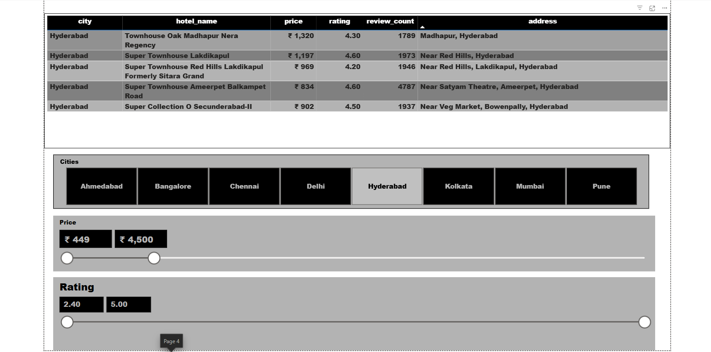

# Hotel-Market-Analysis
## 📌 Project Overview
This project focuses on analyzing OYO hotel data across multiple cities using Python and Power BI. It explores hotel pricing, customer ratings, review counts, and city-wise hotel details to understand hotel information and pricing patterns through an interactive dashboard.

## 🛠️ Tools & Technologies
- Python
- Pandas
- Jupyter Notebook
- Power BI
- CSV Dataset

## 📂 Dataset Information
The dataset contains the following columns:
- **City:** Name of the city.
- **Hotel Name:** Name of the hotel.
- **Price:** Hotel room price.
- **Rating:** Customer rating.
- **Review Count:** Number of customer reviews.
- **Address:** Hotel location.

## ⚙️ Project Workflow
1. Imported the OYO Hotels dataset.
2. Performed data exploration and analysis using Python.
3. Examined hotel prices, ratings, and customer reviews.
4. Used the dataset to create an interactive Power BI dashboard.
5. Added interactive filters for city, price, and rating.

## 📊 Dashboard Features
- City-wise hotel information.
- Hotel price comparison.
- Customer rating analysis.
- Review count analysis.
- Interactive city selection.
- Price range filter.
- Rating range filter.

## 🖼️ Dashboard Preview

## 📁 Project Files
| File Name | Description |
|---|---|
| HOTELS.pbix | Power BI dashboard |
| oyo_hotels_all_cities.csv | OYO Hotels dataset |
| Untitled.ipynb | Python analysis notebook |
| DASHBOARD.png | Dashboard screenshot |
